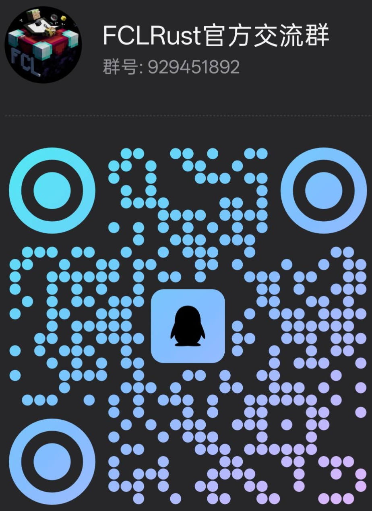
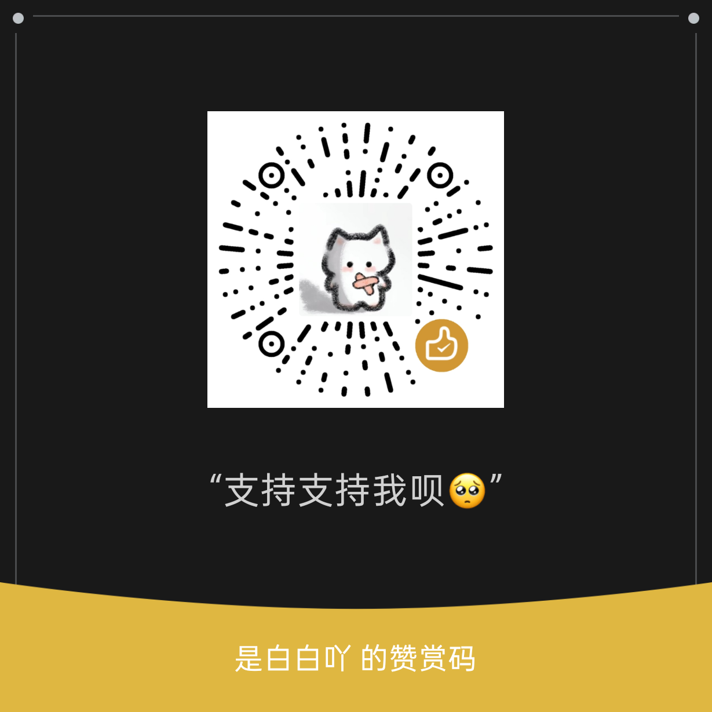

# FCLRust

FCLRust 是一个安卓上的 Minecraft Java 版启动器，我把它做成了**不需要 JVM** 的样子。

启动器界面沿用 Fold Craft Launcher，游戏本身换成了 [Starling](https://github.com/horizon-rust/horizon)——一个用 Rust 重写的 Minecraft Java 版 26.3 引擎。下载、账户、模组管理、控制布局这些仍然是原来那套，玩家看到的还是熟悉的界面；真正跑游戏的是这个 Rust 引擎。

## 和原版启动器有什么不同

- **没有 Java 虚拟机。** 游戏由 Rust 引擎直接运行，启动更快，内存占用更低。
- **资源在设备上生成。** 第一次启动某个版本时，我会用你已有的游戏文件，在本机生成引擎需要的纹理、模型、语言和音效。这一步不上传任何东西。
- **设置项只留有用的。** JVM 版本、内存分配、GL4ES/Krypton 渲染器这些对 Rust 引擎没有意义的选项，我已经从版本设置里移除了。
- **图形后端可以选。** 默认走 Vulkan，也可以切到 OpenGL。

## 怎么用

1. 安装后授予存储权限。
2. 正常添加版本、下载游戏，流程和原版启动器一样。
3. 第一次启动会自动准备引擎资源，会花一点时间，之后启动就快了。
4. 运行游戏。

如果你已经通过其他启动器下载过 26.3，可以让它指向同一个游戏目录，省去重新下载。

## 需要什么

- 安卓设备，arm64
- 支持 Vulkan 的 GPU（部分设备可切到 OpenGL）
- 你自己合法拥有的 Minecraft: Java Edition

这个仓库**不包含**任何 Minecraft 游戏文件，也不会替你下载。

## 说明几点

- 我不是 Mojang 或微软的人，这个项目和它们没有关系。Minecraft 是 Mojang Synergies AB 的商标。
- 引擎和官方客户端的实现不一样，有些行为可能有差异。遇到问题欢迎提 issue，但请不要指望它和官方客户端逐像素一致。
- 目前只做了 arm64，其他架构暂时没有计划。

## 引擎在哪

我用的引擎来自这两个项目：

- [horizon-rust/horizon](https://github.com/horizon-rust/horizon)——引擎本体
- [starling-client/starling](https://github.com/starling-client/starling)——它的安卓移植

引擎的编译交给 CI 完成，产物作为构建依赖使用，不放在这个仓库里。

## 启动器来自哪里

界面和下载逻辑来自 FCL-Team 的 [Fold Craft Launcher](https://github.com/FCL-Team/FoldCraftLauncher)，以 GPL-3.0 发布；其中经由它借用了 PojavLauncher 和 Boat 的部分代码。

## 许可

本项目以 **AGPL-3.0** 发布，全文见仓库根目录的 LICENSE 文件。

由于基于 GPL-3.0 的 Fold Craft Launcher 开发，我希望你分发时也遵循同样的开源精神——改了就要公开。

## 反馈与交流

遇到问题、有想法、或者想贴崩溃日志，都可以提到 Issues。也欢迎直接来群里说，我在。

**QQ 群：929451892**

## 支持我

这个项目是我业余时间做的，不收费，也没有广告。如果它帮你省了事，可以请我喝杯东西，纯粹随意，不影响任何功能。

谢谢每一个愿意反馈、帮忙测试、或者只是用了一下的人。
